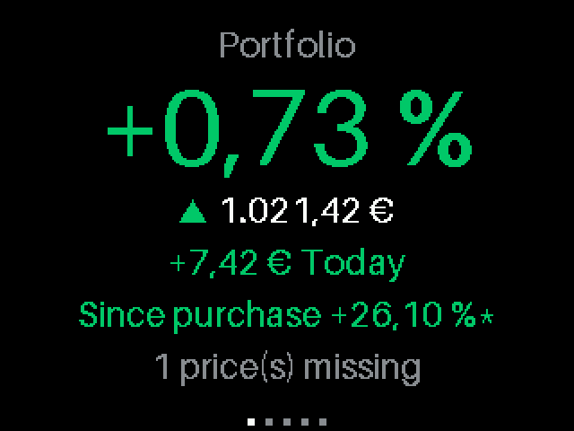
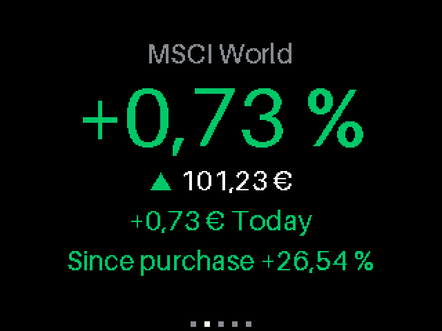
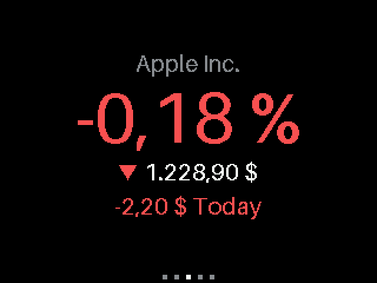
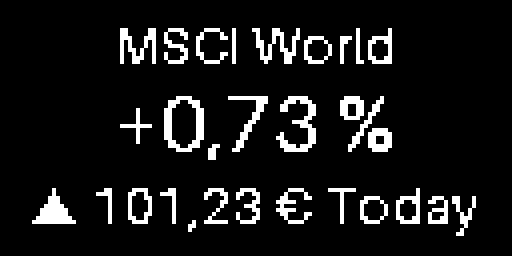
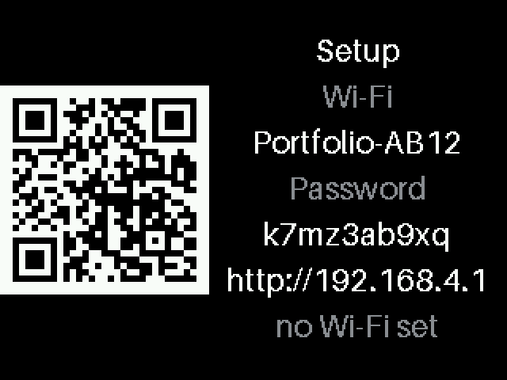
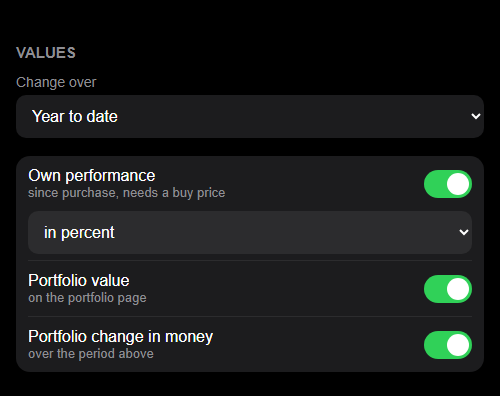

# PortfolioDisplay

A small desk display for your stocks, ETFs and funds. MicroPython on an ESP8266 with a 2.8" TFT or a 0.96" OLED, configured from your phone.

| Your portfolio | One asset | Down day |
|---|---|---|
|  |  |  |

| 0.96" OLED | Setup by QR code | Settings from the phone |
|---|---|---|
|  |  |  |

## Features

- Change in percent as the headline, price below, green/red with a trend arrow
- Own performance since purchase in percent or money, for every asset and the whole portfolio
- Slideshow over your assets, optional portfolio total page, or one static asset
- Change over day, week, year to date or all time
- ISIN, ticker or German WKN; Xetra and the common international exchanges
- Prices from Yahoo Finance, no API key, converted to your currency
- Setup from the phone: scan a QR code, fill in one page
- German or English number format, adjustable brightness, sleep time with automatic summer time
- Wi-Fi password stored encrypted, never sent back to the browser
- Runs in the ~36 KB heap of an ESP8266, TLS included

## Quick start

```bash
uv sync
```

```bash
uv run esptool --port COM4 --baud 460800 write-flash --flash-size=detect 0 ESP8266_GENERIC-20260824-v1.29.0.bin
```

```bash
uv run tools/deploy.py COM4
```

Then scan the QR code on the display. Details in [docs/SETUP.md](docs/SETUP.md).

## Docs

- [docs/SETUP.md](docs/SETUP.md): using the device, flashing, development
- [docs/HARDWARE.md](docs/HARDWARE.md): boards, displays, wiring
- [docs/ARCHITECTURE.md](docs/ARCHITECTURE.md): how the code works
- [docs/3D.md](docs/3D.md): 3D printed desk cases for both displays

## License

[PUNCL 1.0](LICENSE): free for personal and non-commercial use. Commercial use needs written permission.
