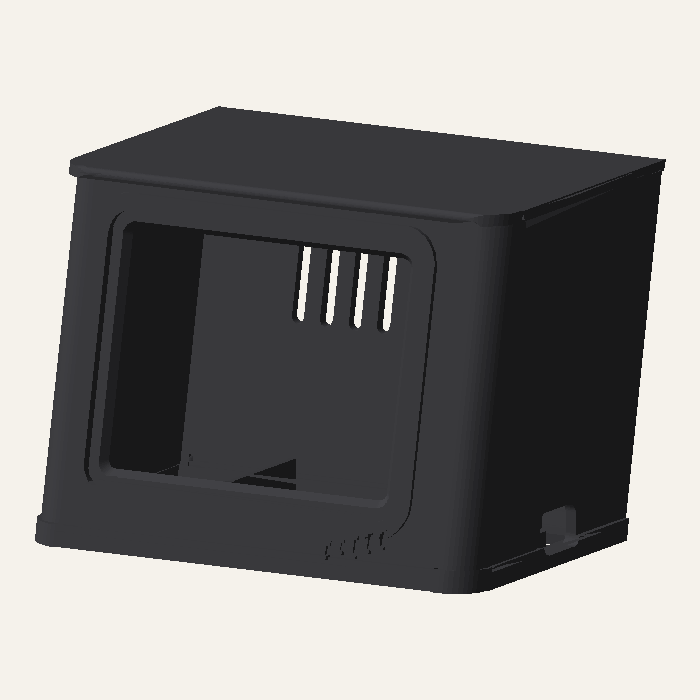
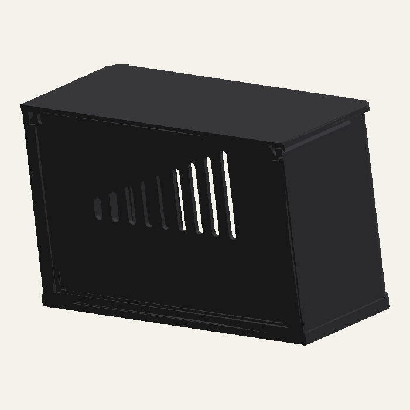
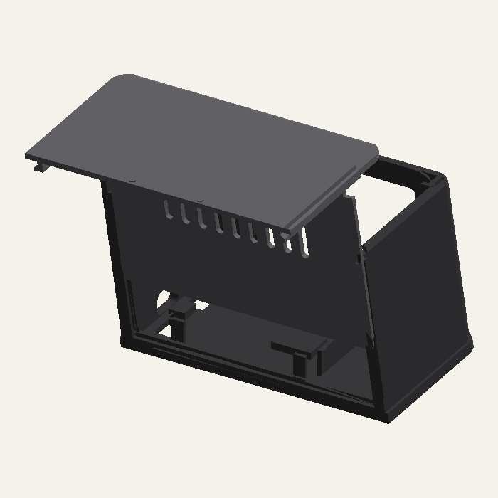
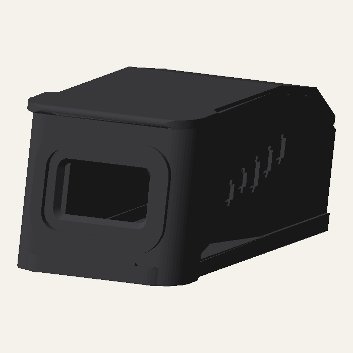
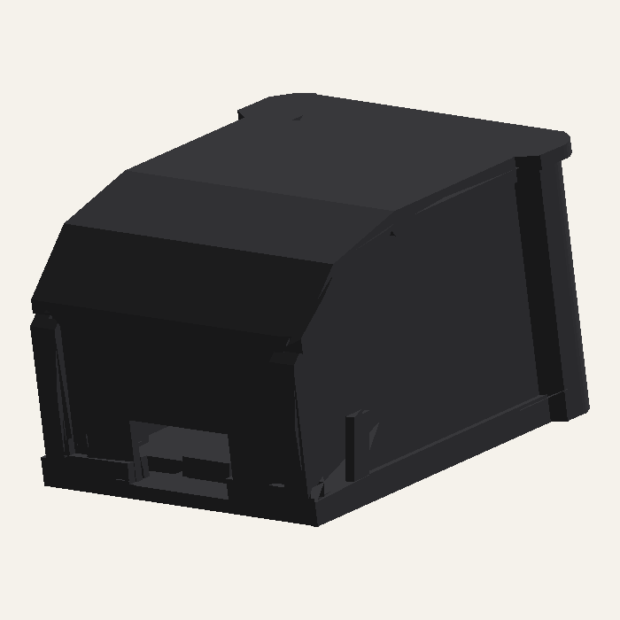
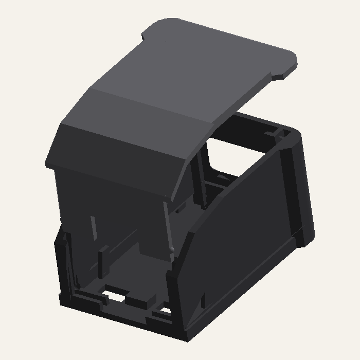

# 3D printed cases

Retro TV style desk cases for both displays, each with a NodeMCU v3 inside. Printed in one color (black PETG), no screws.

**2.8" TFT**

| Front | Back | Opened |
|---|---|---|
|  |  |  |

**0.96" OLED**

| Front | Back | Opened |
|---|---|---|
|  |  |  |

## Files

| File | Content |
|---|---|
| `3d/bambu/tft_case.3mf`, `3d/bambu/oled_case.3mf` | Bambu Studio projects: one plate with all parts and a warm-up badge, all settings set |
| `3d/tft_case.3mf`, `3d/oled_case.3mf` | parts only, for other slicers. TFT: shell, back panel, roof. OLED: shell, cover |
| `3d/tft_fit_frame.stl`, `3d/oled_fit_frame.stl` | front and display slot only, for a quick fit check |
| [tools/case.py](../tools/case.py) | parametric source, display sizes in `VARIANTS` |
| [tools/bambu_project.py](../tools/bambu_project.py) | builds the Bambu projects from the system presets |

```bash
uv run tools/case.py
```

```bash
uv run tools/bambu_project.py
```

The first rebuilds the models and the images above, the second the Bambu projects (needs Bambu Studio). Other printer or filament: `--machine`, `--process`, `--filament` with a Bambu preset name.

## Hardware

| | TFT case | OLED case |
|---|---|---|
| Display | 2.8" ILI9341, blue 8 pin board (ZJY280S0800TG01), PCB 83 x 51.4 mm, pins left | 0.96" SSD1306 I2C, PCB 27.3 x 27.8 mm, pins on top |
| Size | 95 x 71 x 68 mm | 46 x 79 x 38 mm |
| Shape | retro TV | small CRT monitor: wider front frame, roof falls towards the back |
| Board | crosswise, USB-C on the right | lengthwise, USB-C at the back, display wires run between its pin rows |
| Parts | shell, back panel, roof | shell, cover (back panel + roof) |
| Print (P2S defaults) | about 2 h 20 min, 67 g | about 1 h 40 min, 34 g |

Both: NodeMCU v3 (about 58 x 31 mm) with USB-C, Dupont jumper wires (about 10 cm).

The case leans back by 12°. The back panel and the OLED cover are exported leaning the same way, so they sit straight in the rails.

The display sizes come from vendor data, photos and a measurement of the PCB edge. Print the fit frame first: the display should slide in, and the image should sit in the window. Its bottom edge is where the PCB bottom sits in the case.

## Printing

Defaults in the projects; the printer is only a default, the rest works on any Bambu printer.

| | |
|---|---|
| Printer / plate | Bambu P2S, 0.4 nozzle, textured PEI |
| Material | PETG HF, black |
| Layer height | 0.2 mm |
| Walls / infill | 3 / 15 % |
| Supports | tree (auto) |
| Orientation | shell standing; back panel / OLED cover on its back face; TFT roof upside down |
| Extras | 3 skirt loops + warm-up badge to prime the nozzle, thick bridges, no travel across the window, seam at the back, auto brim |

## Assembly

1. Put the NodeMCU upside down (buttons down) between the fences, USB socket at the right wall (TFT) or at the back (OLED).
2. Plug in the wires, then slide the display into the slot behind the window from the top.
3. Slide the back panel (OLED: the cover) down the rails at the back until it clicks.
4. TFT: slide the roof in from the back, its hooks run under the ledges at the top of the side walls. It stops at the front and clicks over the back panel, which it then holds in place.

TFT: keep `TFT_ROTATION = 1` in `src/config.py`, use `3` if the picture is upside down.

**Opening:** TFT: push the roof backwards out of its guides first. Then push a pen through the round hole in the bottom, below the back panel. **RST / FLASH:** reachable with a paperclip through the two slots in the bottom.
