# Setup

- **Part A**: using the device. All you need is a phone.
- **Part B**: flashing and development. Needs a PC with USB.

Wiring: [HARDWARE.md](HARDWARE.md). Code: [ARCHITECTURE.md](ARCHITECTURE.md).

The display images are rendered by the real display code (`tools/sim.py`), left the 0.96" OLED, right the 2.8" TFT. The portal images show the real page (`tools/portal_shots.py`). All data is made up.

# Part A: using the device

## A1. First start

1. Power the device over its USB-C socket (any phone charger). It shows `Starting...`, then the setup screen.
2. Scan the QR code **Scan to join Wi-Fi**. The phone joins `Portfolio-XXXX`. The password is fixed per device and also shown as text.
3. Scan **Scan to open setup** or open `http://192.168.4.1`.

   | | 0.96" OLED (pages rotate every 5 s) | 2.8" TFT |
   |---|---|---|
   | join Wi-Fi |  | 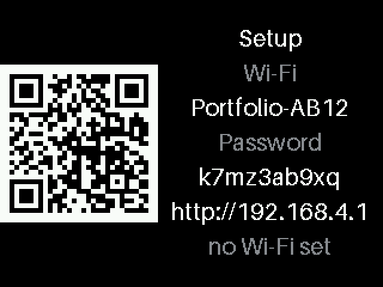 |
   | open page | 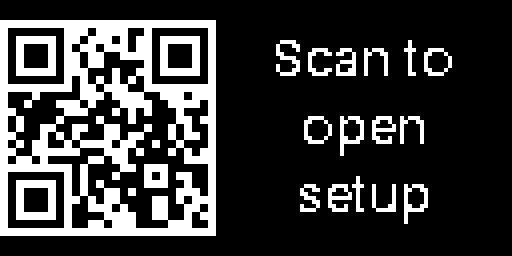 | |
   | as text | 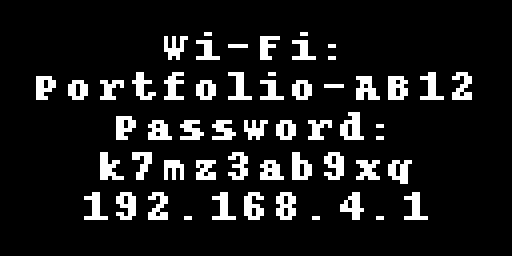 | |

4. Fill in the page (A2) and press **Save**.
5. The device restarts, joins your Wi-Fi, loads the prices and shows the address of the settings page for 10 s. Then the slideshow starts.

Every save restarts the device (about 15 s). If the phone stays in the same Wi-Fi, the page reloads by itself.

## A2. The settings page

| First setup | Configured |
|---|---|
| 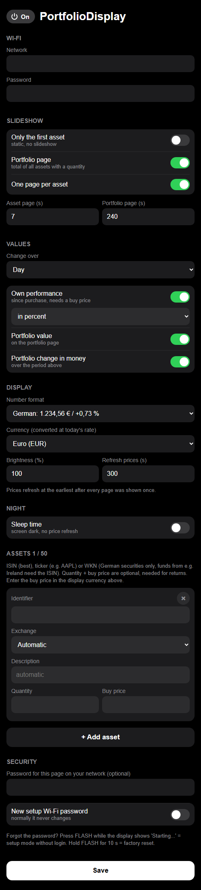 | 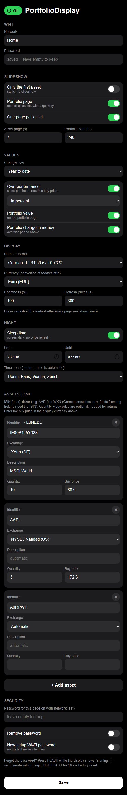 |

**On / Off** (button left of the title): switches the display off and on right away, no Save needed. Off works like the sleep time: screen dark, no price refresh. It stays off after a restart until switched on again.

**Wi-Fi**

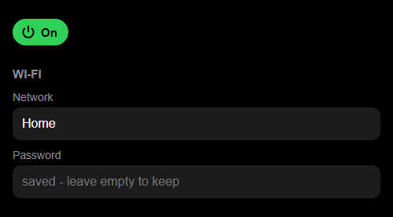

| Field | Meaning |
|---|---|
| Network | your Wi-Fi, networks in range are suggested |
| Password | never shown again. Empty = keep the stored one |

**Slideshow**

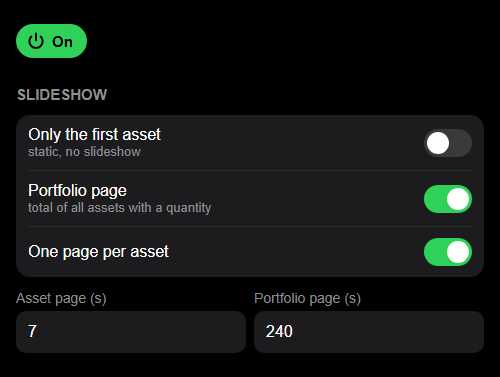

| Field | Meaning |
|---|---|
| Only the first asset | static, no slideshow. Hides the other slideshow options |
| Portfolio page | a page with the total of all assets that have a quantity |
| One page per asset | |
| Asset page / Portfolio page | seconds per page (default 7 / 240) |

**Values**

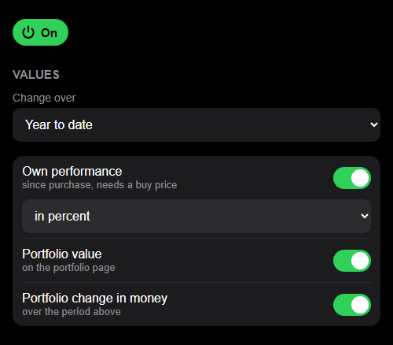

| Field | Meaning |
|---|---|
| Change over | day / week / year to date / all time, for every page |
| Own performance | the "Since purchase" line (default on), in percent or as amount |
| Portfolio value | value of all holdings on the portfolio page (default on) |
| Portfolio change in money | change over the period on the portfolio page (default on) |

**Display**

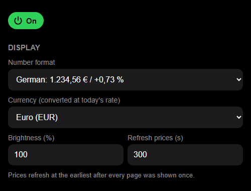

| Field | Meaning |
|---|---|
| Number format | German `1.234,56 €` (default) or English `€1,234.56` |
| Currency | display currency (default EUR), converted at today's rate |
| Brightness | 10-100 % |
| Refresh prices | seconds, at least 60 |

**Night**

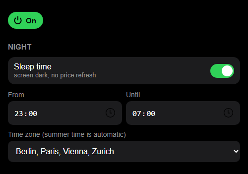

| Field | Meaning |
|---|---|
| Sleep time | between From and Until the screen goes dark and no prices are fetched. Afterwards the device fetches right away |
| Time zone | for the sleep time; summer time switches automatically (EU and US rules). The clock is set over the internet on every refresh |

**Assets** (up to 50)

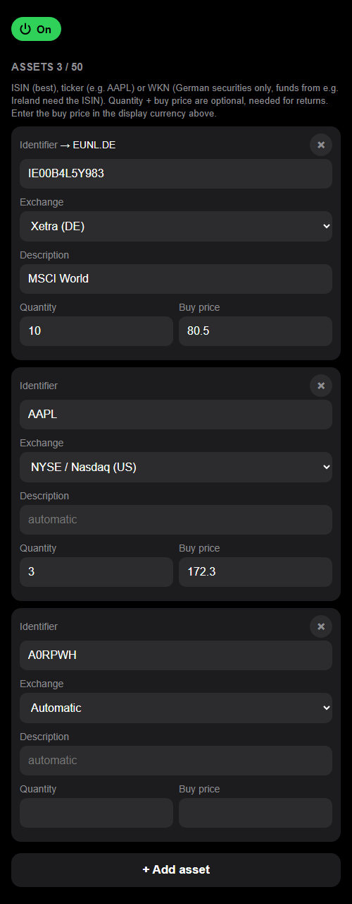

| Field | Example | Note |
|---|---|---|
| Identifier | `IE00B4L5Y983`, `AAPL`, `716460` | ISIN works best. WKN only for German securities. After the first refresh the resolved symbol is shown, e.g. `→ EUNL.DE` |
| Exchange | Xetra, NYSE/Nasdaq, London, ... | `Automatic` prefers Xetra |
| Description | `MSCI World` | optional, default is the name from Yahoo |
| Quantity / Buy price | `10` / `80,50` | optional. Quantity is needed for the total page and the amount, the buy price for "Since purchase". Buy price in the display currency. Empty or `0` = not set |

**+ Add asset** adds a row, **×** removes it. Comma and point both work in numbers.

**Security**

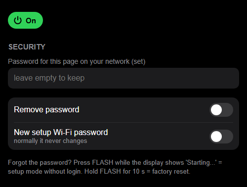

| Field | Meaning |
|---|---|
| Password for this page | optional protection in your home network |
| new setup Wi-Fi password | rolls a new password for the setup Wi-Fi. Normally it never changes |

Phone keyboards don't learn or suggest anything on this page (`autocomplete`, `autocorrect`, `spellcheck` off).

## A3. The FLASH button

FLASH (sometimes labelled BOOT) is one of the two small buttons next to the USB port. The other one is RST (restart).

| What | How |
|---|---|
| show the settings address (QR + IP, 10 s) | short press |
| setup mode, page open without password | press RST, then press FLASH while `Starting...` is shown |
| factory reset | hold FLASH for 10 s. A countdown starts after 2 s, releasing cancels |

| | 0.96" OLED | 2.8" TFT |
|---|---|---|
| settings address | 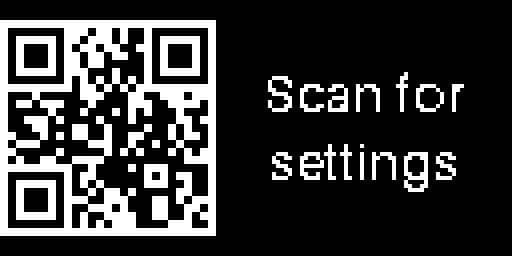 | 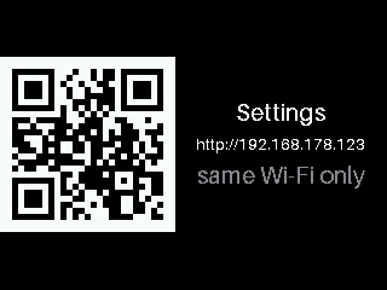 |
| factory reset | 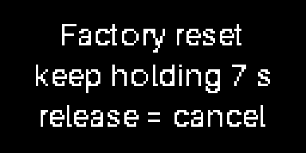 | 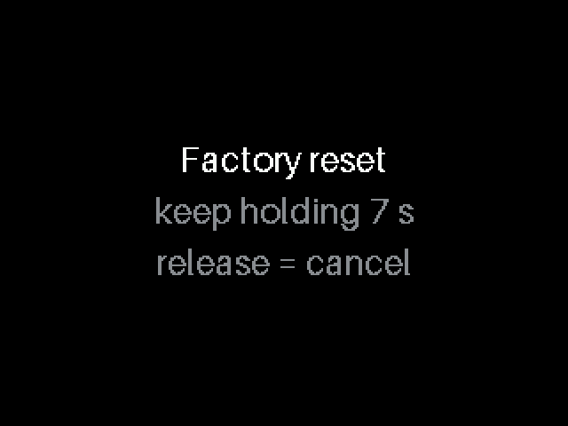 |

Don't hold FLASH while plugging in, the chip then waits for a firmware upload. Press RST to get out.

During the sleep time a short press shows the settings address too; afterwards the screen goes dark again.

A factory reset clears Wi-Fi, assets and the page password. The setup Wi-Fi password stays.

## A4. Forgot a password?

| Password | Fix |
|---|---|
| settings page | force setup mode (A3), the page is open there |
| home Wi-Fi changed | after 20 s without Wi-Fi the device enters setup mode by itself |
| setup Wi-Fi | shown on the display in setup mode |

## A5. What the display shows

Asset and total page look the same:

1. name (or `Portfolio`)
2. change in percent over the chosen period, green = up, red = down
3. price (total: value of all holdings, can be switched off) with a trend arrow
4. change in money over the period
5. own performance since purchase, in percent or as amount (can be switched off)

The OLED only fits lines 1-3. Dots at the bottom mark the slideshow position.

**Pages** (section Slideshow)

| Switches on | Pages |
|---|---|
| Portfolio page + One page per asset | portfolio page first, then one page per asset |
| One page per asset | one page per asset |
| Portfolio page | one page with the total of all holdings |
| Only the first asset | one fixed page, no slideshow |

With both page switches off the device falls back to one page per asset.

**Own performance** (section Values, line 5 on every page)

| Mode | Shows | Needs |
|---|---|---|
| in percent | gain or loss since buying in % | buy price |
| as amount | gain or loss since buying in money | buy price + quantity (without quantity: per share, marked `*`) |
| off | no line | nothing |

**Portfolio page**

| Line | Switch | Counts |
|---|---|---|
| change in % (headline) | always | assets with a quantity |
| value of all holdings | Portfolio value | assets with a quantity |
| change in money | Portfolio change in money | assets with a quantity |
| own performance | Own performance | assets with quantity + buy price |

Assets without the needed values are left out, and a `*` behind the own performance shows that something was left out. Everything off except the headline leaves a minimal page.

| | 0.96" OLED | 2.8" TFT |
|---|---|---|
| asset, up |  | 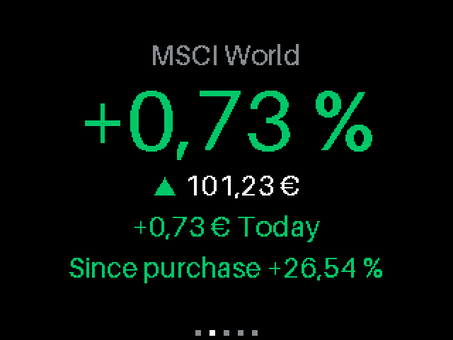 |
| asset, down | 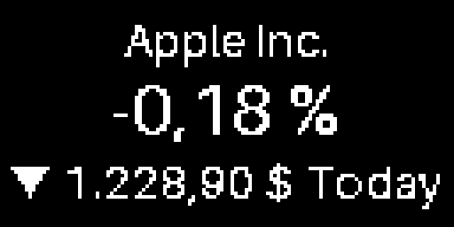 | 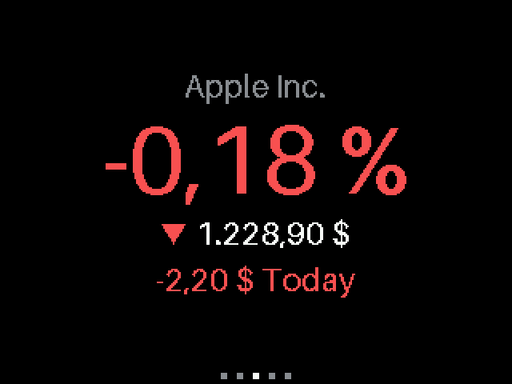 |
| portfolio total | 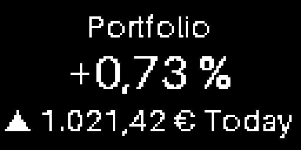 | 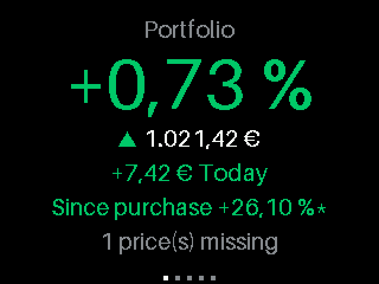 |
| own performance as amount | | 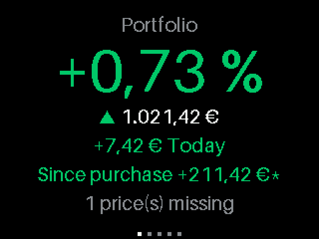 |
| own performance off | | 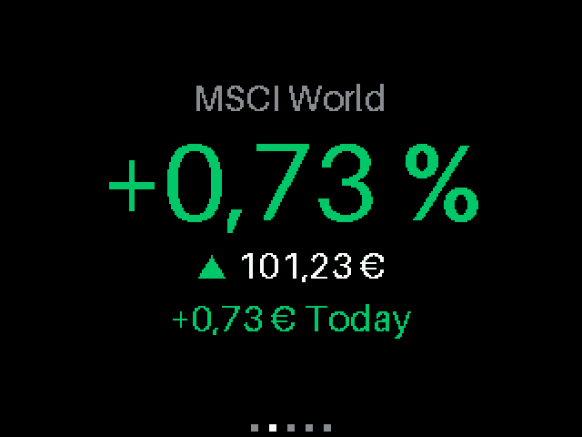 |
| portfolio, value and change off | | 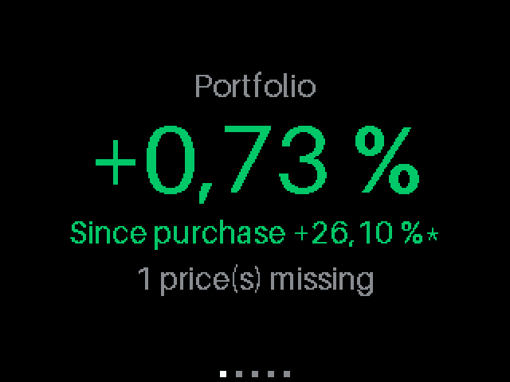 |
| only the first asset | 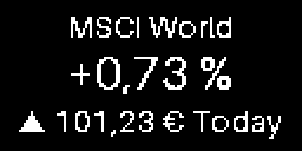 | 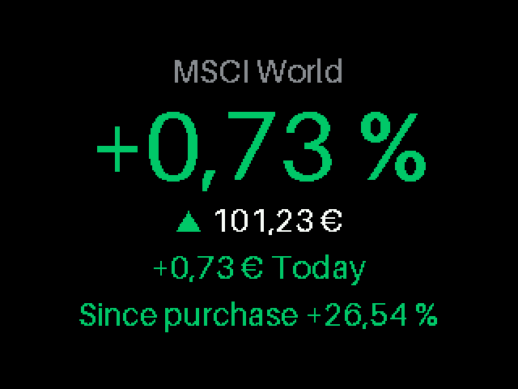 |
| English number format | 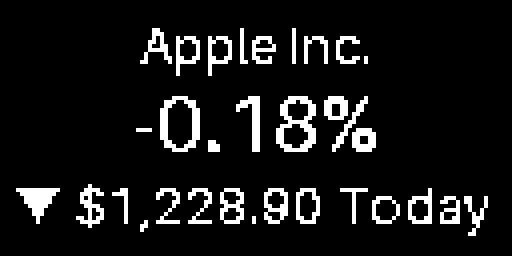 | 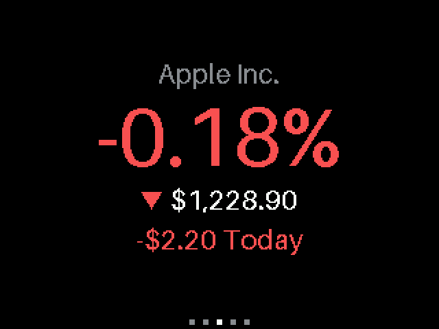 |
| brightness 40 % | |  |
| identifier not found | 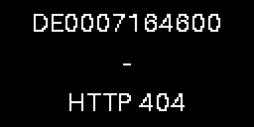 | 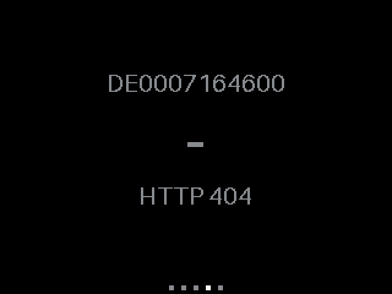 |

Messages:

- `Loading...`: the first refresh is still running.
- `HTTP 404`, `not found`, `not on this exchange`: check identifier and exchange.
- `WKN: use the ISIN`: WKNs only resolve for German securities.

**Refresh.** When a refresh is due, the picture stands still for a few seconds (about 9 s with 2 assets, 2-3 s per further asset, 10 assets per refresh) and then continues with new prices. A refresh never comes before every slide was shown once, and the device stretches short intervals so that the picture moves at least 80 % of the time.

# Part B: flashing and development

## B1. Requirements

- A USB-C data cable (not a charge-only one) and the driver for the board's serial chip (CH340 on the NodeMCU v3). The port shows up as `COMx`.
- [uv](https://docs.astral.sh/uv/). It installs the right Python version itself.
- MicroPython firmware for the ESP8266 from <https://micropython.org/download/ESP8266_GENERIC/>, put the `.bin` into the project folder.

```bash
uv sync
```

## B2. Flash the firmware (once per board)

```bash
uv run esptool --port COM4 erase-flash
```

```bash
uv run esptool --port COM4 --baud 460800 write-flash --flash-size=detect 0 ESP8266_GENERIC-20260824-v1.29.0.bin
```

`erase-flash` also removes all settings and the setup Wi-Fi password.

## B3. Configure and deploy

1. Adjust `src/config.py` to your hardware, see [HARDWARE.md](HARDWARE.md).
2. OLED only, once:
   ```bash
   uv run tools/mpr.py connect COM4 mip install ssd1306
   ```
3. Deploy:
   ```bash
   uv run tools/deploy.py COM4
   ```
   Compiles everything to `.mpy`, removes stale code from the board (settings stay), uploads and restarts.

Always use `tools/mpr.py` instead of plain `mpremote`. On these boards plain `mpremote` holds the ESP in reset (`could not enter raw repl`).

## B4. Tools

| Command | Purpose |
|---|---|
| `uv run tools/sim.py` | render every screen on the PC into `docs/img/<size>/` |
| `uv run tools/portal_shots.py` | screenshots of the settings page into `docs/img/portal/` (needs Edge or Chrome) |
| `uv run tools/make_fonts.py` | rebuild the fonts |
| `uv run tools/mpr.py connect COM4 repl` | console of the board, shows the device log |
| `uv run tools/mpr.py connect COM4 ls` | files on the board |

## B5. Display diagnostics

Each script explains in its header what to expect. Run them in this order:

```bash
uv run tools/mpr.py connect COM4 run tools/diag/bus_check.py
```

Does the controller answer? Needs MISO, no need to look at the screen.

```bash
uv run tools/mpr.py connect COM4 run tools/diag/probe.py
```

Which controller and SPI mode fit? The variant with a clean digit on red is the right one.

```bash
uv run tools/mpr.py connect COM4 run tools/diag/stages.py
```

Which layer loses the picture (init, hardware SPI, speed)?

Screenshot of the real panel (reads its video memory, needs MISO):

```bash
uv run tools/diag/screenshot.py COM4 --wait 45 --out shot.png
```
